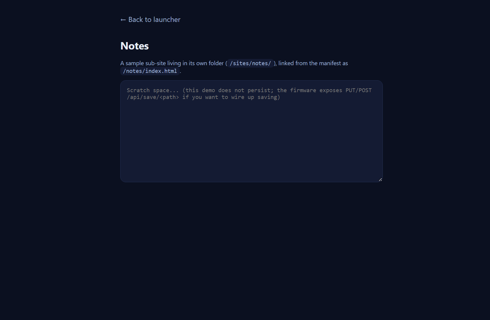

# Nexus Sites

A small collection of browser-powered games and tools, served straight off a microSD card
by a [Nexus](https://github.com/nikhilsaps/Nexus) Cardputer (ESP32-S3) over your LAN. No
cloud and no PC are required on the device — and because every site is plain static files,
the exact same folder also runs in any ordinary browser or static web host.


The home page is a light, minimal launcher that reads `sites/metadata.json` and lists
whatever is hosted. Add a site, add one entry, and it appears here automatically.

---

## Sites

Sites are listed in the order they appear in the launcher. Each one is a self-contained
folder or file under `sdcard_stage/sites/` and keeps its own look. New sites get their own
section and screenshot below.

### 1. Chess Master — `/chess/`

Play Stockfish, explore openings and practice tactics. The engine runs entirely in your
browser; nothing is sent anywhere.


### 2. WiFi Sniffer — `/sniff/index.html`

A live probe and client logger. It streams data captured by the device, so it only shows
anything while **Sniffer mode** is running on the Cardputer (no static screenshot).

### 3. Notes — `/notes/index.html`

A sample sub-site that lives in its own folder — a template for your own pages.



### 4. About Nexus — `/about.html`

What this little web host is and how the firmware serves files.


### 5. Nexus on GitHub — external

A tile linking to the firmware source. It opens off-device and needs internet.

---

## Repository layout

```
nexus-sites/
  sdcard_stage/            # copy the CONTENTS of this to the microSD root
    sites/                 # the web root the firmware serves (/sdcard/sites)
      index.html           # the launcher (the home page shown above)
      metadata.json        # the list of sites the launcher renders
      about.html
      notes/index.html
      sniff/index.html
      chess/               # Chess Master build output (from chess-master/)
    captive/               # captive-portal pages (see Additions)
    duck/                  # BadUSB / HID payloads (see Additions)
  chess-master/            # Chess Master SOURCE (built into sites/chess)
  scripts/assemble.py      # builds the apps in sites.json into the web root
  sites.json               # which app sources get built, and where
  docs/                    # screenshots and guides
```

## Deploy to the Cardputer

Copy the **contents** of `sdcard_stage/` to the root of the microSD card, so the card has
`/sites`, `/captive` and `/duck` at its top level. The firmware serves `/sites` at
`http://<device-ip>/`.

## Run anywhere (no ESP32)

The sites are just static files, so any static server works:

```sh
cd sdcard_stage/sites
python -m http.server 8000
# open http://localhost:8000/
```

## Building the apps

Static sites (About, Notes, Sniffer) need no build — they are authored directly in
`sdcard_stage/sites/`. Apps that have a build step are listed in `sites.json` and compiled
into the web root by:

```sh
# build the app first (example: Chess Master)
cd chess-master && npm install && npm run build && cd ..
# then copy builds into sdcard_stage/sites/<mount>
python scripts/assemble.py
```

`assemble.py` swaps each build in atomically and keeps the previous copy under
`.build-backups/` (ignored by git), so a failed run never leaves a half-written site. It
also checks that every launcher link resolves inside the web root.

## Adding a new site

1. Drop a static site into `sdcard_stage/sites/<name>/` (or build an app and register it in
   `sites.json`).
2. Add an entry to `sdcard_stage/sites/metadata.json` (`name`, `path`, `desc`, `icon`,
   `tags`). Link folders with an explicit file, e.g. `/<name>/index.html` — the firmware
   does not auto-index folders.
3. Add a screenshot under `docs/screenshots/<name>/` and a section to this README.

See [`docs/ADDING-A-SITE.md`](docs/ADDING-A-SITE.md) and
[`docs/SITE-TEMPLATE.md`](docs/SITE-TEMPLATE.md) for details.

## Additions: captive portal and BadUSB payloads

Two folders ride along on the SD card for other Cardputer modes. They are **not** part of
the web launcher: the firmware confines HTTP to `/sites`, so these are reached only by
their own modes, not from the home page.

- **`captive/`** — HTML pages for the captive-portal mode.
- **`duck/`** — HID / BadUSB keystroke payload scripts.

Use these only on hardware and networks you own or are authorised to test.
