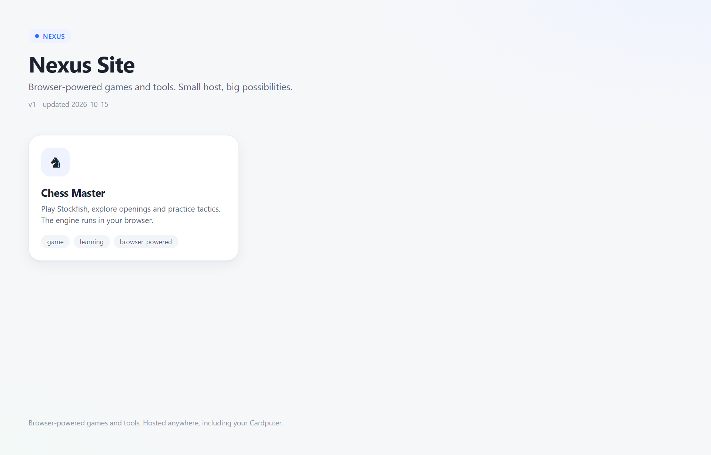
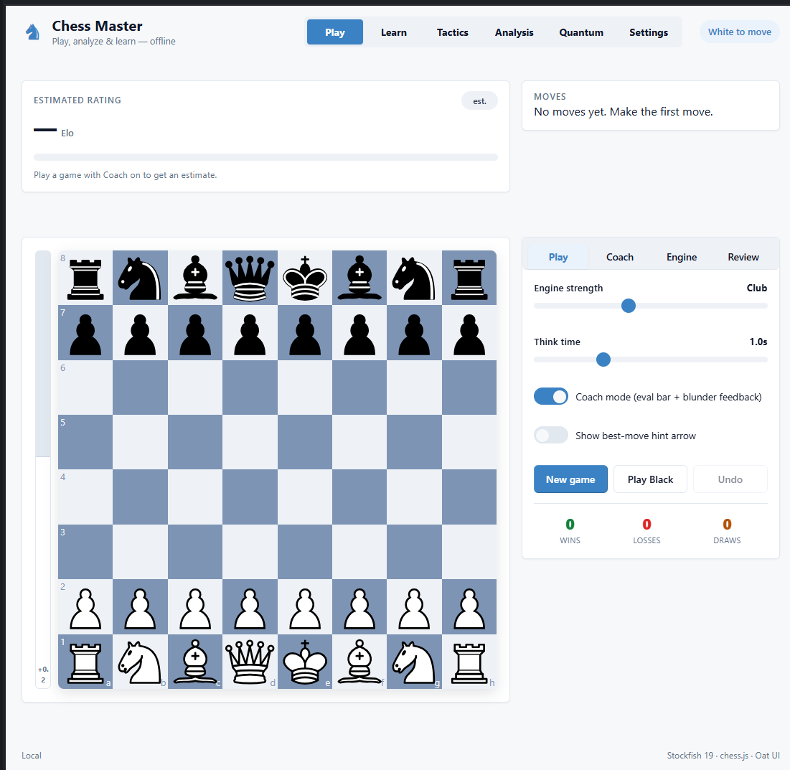
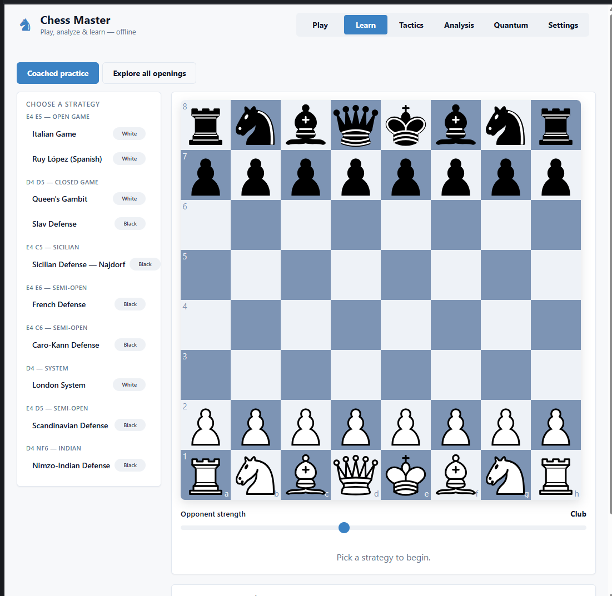
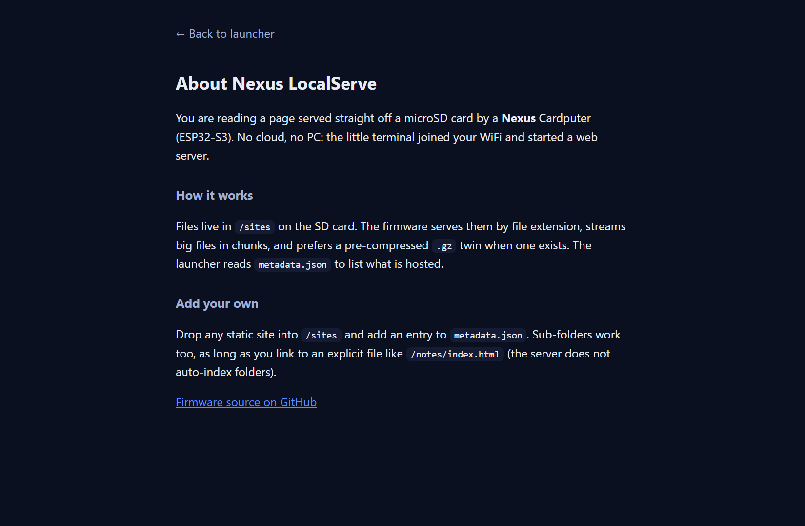

# Nexus Sites

A small collection of browser-powered games and tools, served straight off a microSD card
by a [Nexus](https://github.com/nikhilsaps/Nexus) Cardputer (ESP32-S3) over your LAN. No
cloud and no PC are required on the device — and because every site is plain static files,
the exact same folder also runs in any ordinary browser or static web host.



The home page is a light, minimal launcher that reads `sites/metadata.json` and lists
whatever is hosted, split into **Apps** and **Tools**. Add a site, add one entry, and it
appears here automatically.

This repo manages two things that live on the card: **`sites/`** (the web root — every
HTML page the device can serve, including the on-device tool pages) and **`duck/`** (BadUSB
keystroke payloads, which are plain text and never served over the web).

---

## Using it with Nexus

This repo is the **content side** of the [Nexus](https://github.com/nikhilsaps/Nexus)
Cardputer firmware. The firmware is the code that runs on the device; this repo is
everything that firmware reads off the microSD card. The two line up like this:

| Nexus firmware mode | Reads from this repo |
|---------------------|----------------------|
| **LocalServe** (web host over Wi-Fi / USB-NCM) | the whole `sites/` web root, served at `http://<device-ip>/` |
| **Evil-Twin** (captive portal) | the pages in `sites/captive/` |
| **Wi-Fi Sniffer** (viewer) | `sites/sniff/index.html` |
| **Ducky / BadUSB** | the `.txt` payloads in `duck/` |

Flow: clone this repo, build any apps that have a build step, then run
`python scripts/deploy.py --dest <DRIVE>` to mirror `sites/` and `duck/` onto the SD
card. Flash the Nexus firmware, insert the card, and the device serves and runs exactly
what is in here. Because every site is plain static files, you can also open `sites/`
in any browser with no Cardputer at all (see **Run anywhere** below).

## Sites

Sites are listed in the order they appear in the launcher. Each one lives under `sites/`
and keeps its own look. The `kind` field in `metadata.json` groups them: `app` for games
and pages, `tool` for device features.

### 1. Chess Master — `/chess/` (app)

Play Stockfish, explore openings and practice tactics. The engine runs entirely in your
browser; nothing is sent anywhere. Source lives in `sites/chess-master/`; the build is
produced into `sites/chess/`.




### 2. About Nexus — `/about.html` (app)

What this little web host is and how the firmware serves files.



### 3. Nexus on GitHub — external (app)

A tile linking to the firmware source. It opens off-device and needs internet.

### 4. WiFi Sniffer — `/sniff/index.html` (tool)

A live probe and client logger. It streams data captured by the device, so it only shows
anything while **Sniffer mode** is running on the Cardputer (no static screenshot).

### 5. Evil-Twin Pages — `/sites/captive/` (tool)

The captive-portal page set for the Evil-Twin mode. These pages are picked and served from
the device during a run, not browsed from the launcher, so the launcher shows them as an
"on device" card with no link. The firmware reads `*.html` straight out of `sites/captive/`.

---

## Repository layout

```
nexus-sites/
  sites/                 # the web root the firmware serves (/sdcard/sites)
    index.html           # the launcher (the home page shown above)
    metadata.json        # the list of sites the launcher renders (with `kind`)
    about.html
    sniff/index.html     # WiFi Sniffer viewer (tool)
    captive/*.html       # Evil-Twin captive-portal pages (tool, served on-device)
    chess-master/        # Chess Master SOURCE project (Vite) — never copied to the card
    chess/               # Chess BUILD output (generated by assemble.py; git-ignored)
  duck/                  # BadUSB / HID payloads (plain text; served on-device, not over HTTP)
  scripts/assemble.py    # stages built apps (sites.json) into the web root
  scripts/deploy.py      # assembles + copies the card structure to a drive
  sites.json             # web_root, sd_root, and which app sources get built
  docs/                  # screenshots and guides
```

Source and static pages are committed. Generated builds (`sites/chess/`, any `dist/`,
`node_modules/`) are **not** committed — you produce them and deploy the build onto the card.

## Build, then deploy to the card

```sh
# 1. build each app that has a build step (example: Chess Master)
cd sites/chess-master && npm install && npm run build && cd ../..

# 2. assemble the builds + copy the card structure to the SD drive
python scripts/deploy.py --dest D:\         # Windows drive letter, or a mount path
```

`deploy.py` runs `assemble.py` to stage each build into the web root, then mirrors the
shipped trees (`sites.json` `sd_root`, default `sites/` and `duck/`) onto the target so the
card exactly matches the repo. Only built, servable files reach the card: each app's
`source` tree from `sites.json`, `node_modules/` and build backups are **never** copied.

Useful flags:

- `--dry-run` — show what would copy/delete/prune, write nothing.
- `--prune` — also remove top-level items on the card that aren't shipped (e.g. an old
  `/captive` folder from a previous flat layout).
- `--no-assemble` — skip the build-staging step and mirror the current files as-is.

The firmware serves `/sites` at `http://<device-ip>/`.

## Run anywhere (no ESP32)

After building, any static server works:

```sh
cd sites
python -m http.server 8000
# open http://localhost:8000/
```

`assemble.py` swaps each build in atomically and keeps the previous copy under
`.build-backups/` (git-ignored), so a failed run never leaves a half-written site. It also
checks that every launcher link resolves inside the web root.

## Adding a new site

1. Put the project in `sites/<name>/` (a built app) or author a static page directly in
   `sites/`.
2. For a built app, register it in `sites.json` (`id`, `source`, `output`, `mount`) so
   `assemble.py` builds it into `sites/<mount>/`. Its `source` tree is auto-excluded from
   the card by `deploy.py`.
3. Add an entry to `sites/metadata.json` (`name`, `kind`, `desc`, `icon`, `tags`, and a
   `path` if it has a browsable page). `kind` is `app` or `tool`. Link folders with an
   explicit file, e.g. `/<name>/index.html`. Omit `path` for a device-only tool.
4. Run `python scripts/deploy.py --dest <DRIVE>`. A static site needs no script change at
   all — it is mirrored automatically.
5. Add a screenshot under `docs/screenshots/<name>/` and a section to this README.

See [`docs/ADDING-A-SITE.md`](docs/ADDING-A-SITE.md) and
[`docs/SITE-TEMPLATE.md`](docs/SITE-TEMPLATE.md) for details.

For the firmware HTTP APIs a page can call, see
[`docs/CAPTIVE-PORTAL-API-GUIDE.md`](docs/CAPTIVE-PORTAL-API-GUIDE.md) (isolated
Evil-Twin SoftAP, `/api/<name>` JSON store, no internet) and
[`docs/LOCALSERVE-API-GUIDE.md`](docs/LOCALSERVE-API-GUIDE.md) (LAN serving,
`/api/fetch` internet proxy, `/api/save` file store, `/api/stat` heap).

## Note on the tool pages and payloads

The captive-portal pages (`sites/captive/`) and BadUSB payloads (`duck/`) are used by the
Cardputer's own Wi-Fi and HID modes, not by the web launcher. Use them only on hardware and
networks you own or are authorised to test.
